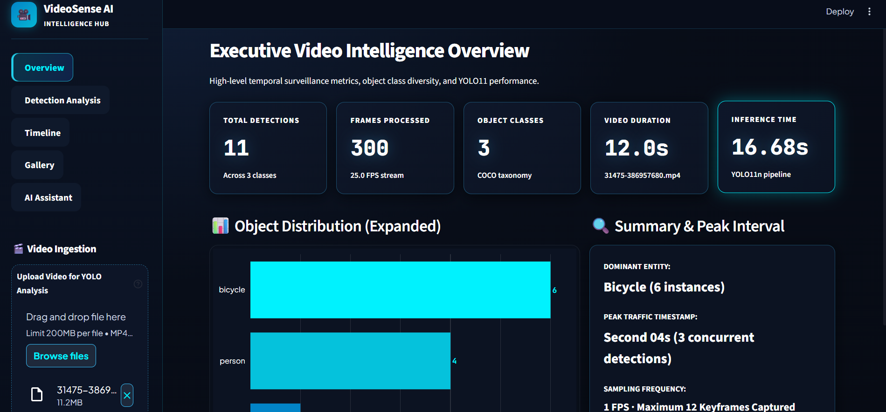

# VideoSense AI — Intelligent Video Analytics Dashboard

VideoSense AI is a Python-based video analytics application that uses computer vision to detect objects in uploaded videos and present the results through an interactive dashboard.

## Features

- **Object Detection:** Uses YOLO and OpenCV to process video frames and detect objects.
- **Analytics Dashboard:** Displays object detection summaries and visualizations.
- **Timeline Analysis:** Explores detections across sampled video frames.
- **Annotated Frame Gallery:** Presents selected frames with detection annotations.
- **AI Assistant:** Integrates the Groq API to answer natural-language questions about video analysis results.

## Tech Stack

- Python
- Streamlit
- Ultralytics YOLO
- OpenCV
- Pandas
- Plotly
- Groq API

## Getting Started

### 1. Clone the repository

```bash
git clone YOUR_REPOSITORY_URL
cd VideoSense-AI
```

Replace `YOUR_REPOSITORY_URL` with the HTTPS URL of your GitHub repository.

### 2. Create a virtual environment

```bash
python -m venv venv
```

Activate it on Windows:

```bash
venv\Scripts\activate
```

### 3. Install dependencies

Install the packages listed in `requirements.txt`:

```bash
pip install -r requirements.txt
```

### 4. Configure the Groq API

Create a `.env` file locally and store your API key there. Never commit this file or publish your API key.

The application must be configured to read the key using the environment-variable name expected by its code.

### 5. Run the application

```bash
streamlit run app.py
```

If your main Python file has a different name, replace `app.py` with that filename.

## Usage

1. Launch the Streamlit application.
2. Upload a supported video file.
3. Run the object-detection analysis.
4. Explore the analytics, timeline, and annotated-frame gallery.
5. Ask the AI assistant questions about the available analysis results.

## Notes and Limitations

- Detection results depend on the model, video quality, confidence threshold, and sampled frames.
- Detected objects may include false positives or missed detections.
- The AI assistant's answers depend on the evidence provided to it.
- Initial model loading and video processing may take time.

## Security

Do not commit API keys, `.env` files, private videos, or sensitive data.

## Dashboard Preview



## Author

Shambhavi Shrivastava
